  

  
  
  
  

### Abdulkarim Alshudukhi &nbsp;·&nbsp; 

Android and platform engineer who works close to the system: LSPosed/Zygisk modules that survive real devices, Kotlin and Compose products, and a Next.js portfolio shipped as an MIT template.
Software Engineering student at the University of Ha'il (GPA 3.626/4.0) · Ha'il, Saudi Arabia.

## What I build

- **System-level Android** — LSPosed/Zygisk modules and AIDL IPC, written to be reversible and to never modify system files.
- **Product Android** — Kotlin, Compose M3, Hilt, Room; offline-first, shipped in AR/EN/FR with full RTL.
- **Web** — Next.js 16, TypeScript, Tailwind, GSAP/Three.js; the portfolio is public as an MIT template.

## Shipped

<table>
  <tr><th align="left">Project</th><th align="left">Why it's hard</th><th align="left">Traction</th></tr>
  <tr>
    <td><a href="https://github.com/kvmy666/duoStatusBar"><b>duoStatusBar</b></a></td>
    <td>Re-lays out a dual-screen status bar at runtime via LSPosed hooks, with fallback when the OEM surface differs.</td>
    <td> </td>
  </tr>
  <tr>
    <td><a href="https://github.com/kvmy666/AutoExpandNotifications"><b>AutoExpandNotifications</b></a></td>
    <td>Forces the shade to expand and keeps heads-up behaviour intact across OEM notification stacks.</td>
    <td> </td>
  </tr>
  <tr>
    <td><a href="https://github.com/kvmy666/iosEmojis-Font-module"><b>iOS Emojis</b></a></td>
    <td>Injects the iOS emoji font as a systemless Shell/Magisk module and restores cleanly on disable.</td>
    <td> </td>
  </tr>
  <tr>
    <td><a href="https://github.com/kvmy666/Gboard"><b>Gboard+</b></a></td>
    <td>Adds clipboard and joystick tooling to Gboard through module hooks instead of patching the APK.</td>
    <td> </td>
  </tr>
</table>

<a href="https://github.com/kvmy666?tab=repositories">All projects →</a>

## Stack

**Android / Kotlin** —     

**Systems / Root** —    

**Web / Tooling** —   

## By the numbers

  
  

## Now

- Finishing my BSc in Software Engineering at the University of Ha'il.
- Building **abdulkarim.dev** — case studies for the modules and apps above.
- Interviewing for a 28-week co-op starting January 2027.

> I take apart the parts of Android you're not supposed to touch — then ship them.

<b>kvmy666</b>

